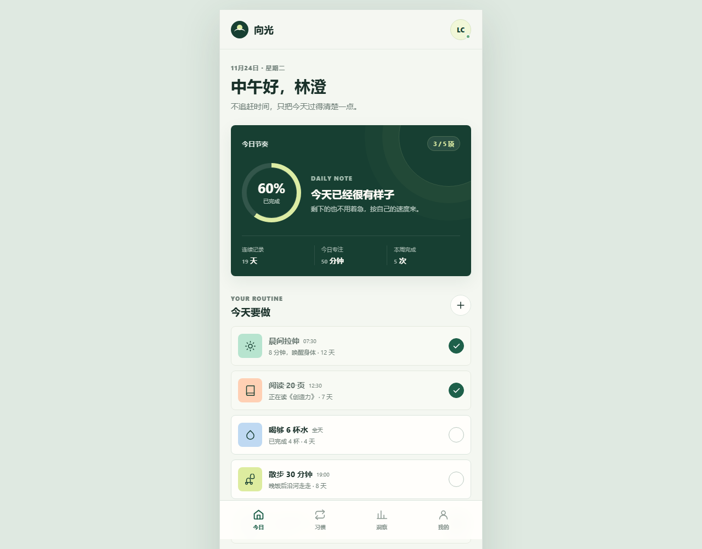

# 向光 · 每日习惯

一个移动端优先的习惯与专注管理 PWA。界面围绕单手操作设计，数据保存在浏览器本地，不依赖后端、第三方字体或 CDN。



## 功能

- 今日完成度、连续记录、专注时长与心情记录
- 习惯打卡、按时段筛选、新增和删除
- 25 分钟专注计时器
- 一周趋势与近四周打卡热力图
- 提醒偏好、今日重置与 PWA 安装入口
- `localStorage` 持久化，跨刷新保留数据

## 本地运行

```bash
npm run dev
```

浏览器打开 `http://localhost:4173`。项目没有第三方依赖，Node.js 20 及以上即可运行。

## 验证

```bash
npm test
npm run check
```

## 项目结构

```text
daylight-mobile/
├── assets/                 应用图标
├── css/styles.css          移动端界面样式
├── js/app.js               界面交互与本地状态
├── js/domain.js            日期、状态与习惯领域逻辑
├── tests/domain.test.mjs   领域逻辑测试
├── index.html              应用入口
├── manifest.webmanifest    PWA 配置
├── server.mjs              零依赖静态服务器
└── sw.js                   离线缓存
```
